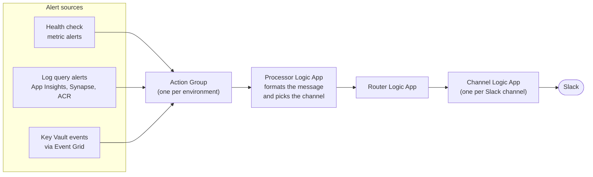
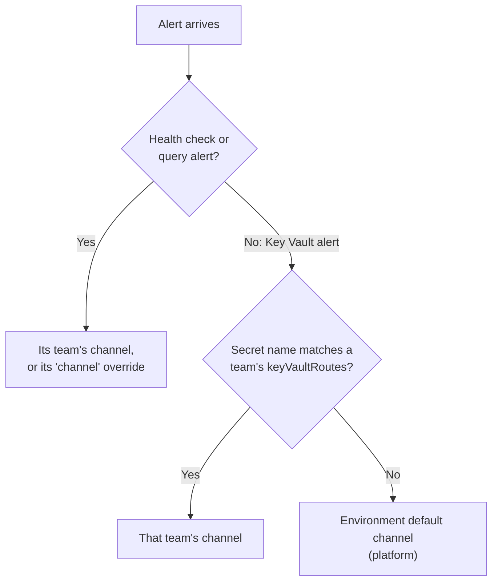
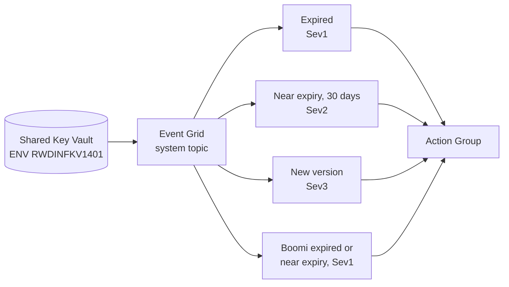
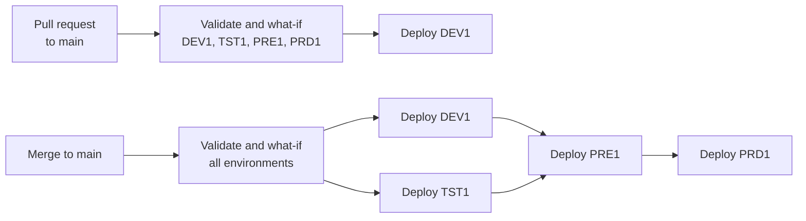

# EPR Shared Alerting 🚨

Sends EPR Azure alerts to Slack. Teams add alerts by editing JSON files in `data/`, and a pipeline deploys them to every environment.

## How it works



1. **Alert sources** fire. Each one is defined in a JSON file under `data/`.
2. **Every alert goes to one Action Group**, which calls the processor.
3. **The processor** turns the alert into a Slack message and decides which channel it goes to. For Key Vault alerts it adds the secret name, vault and expiry date.
4. **The router** passes the message to the Logic App for that channel.
5. **The channel Logic App** posts it to Slack, using the webhook stored in the Key Vault as `slack-webhook-<channel>`.

## Which channel does an alert go to?

Each team's alerts go to that team's channel: `epr-alerts-<team>-prod` in PRD and `epr-alerts-<team>-non-prod` everywhere else. An alert can set `channel` to override this.



If the channel isn't deployed in that environment (`channelInterfaces` in `params/<env>.bicepparam`), the alert goes to the environment default instead.

## Which file do I edit?

Each team has one file: `data/<team>/alerts.json`. `<team>` is one of `manage-account`, `manage-liabilities`, `meet-obligations`, `platform`, `regulator-tooling` or `submit-data`.

| I want to... | Edit |
| --- | --- |
| Alert when a web or function app's health check fails | `healthChecks` in `data/<team>/alerts.json` |
| Alert on an App Insights or Log Analytics query | `queryAlerts` in `data/<team>/alerts.json` |
| Send alerts for my team's Key Vault secrets to my team's channel | `keyVaultRoutes` in `data/<team>/alerts.json` |
| Get expiry alerts for a secret or certificate | Nothing. See [Key Vault alerts](#key-vault-alerts). |
| Change which Key Vault events alert, or their severity | `data/platform/keyvault-event-subscriptions.json` |
| Add a team | Add a folder with an `alerts.json`, and one line to `teamFiles` in `main.bicep` |
| Add a Slack channel to an environment | `params/<env>.bicepparam` (`channelInterfaces`), plus a `slack-webhook-<channel>` secret in that environment's vault |
| Change the Slack message format or routing logic | `modules/logicApp/slack-commonAlertSchema.bicep` |

### alerts.json

Only `app`, `resourceGroup`, `name`, `query` and `target` are required. Everything else has a default.

```json
{
  "healthChecks": {
    "DEV1": [{ "app": "DEVRWDWEBWA1401", "resourceGroup": "DEVRWDWEBRG1401" }],
    "PRD1": [{ "app": "PRDRWDWEBWA1401", "resourceGroup": "PRDRWDWEBRG1401" }]
  },
  "queryAlerts": [
    {
      "name": "Synapse-PipelineRun-Failed",
      "description": "A Synapse pipeline run failed ({env} environment)",
      "query": "SynapseIntegrationPipelineRuns | where Status =~ \"Failed\"",
      "frequency": "PT30M",
      "environments": {
        "DEV1": { "target": "/subscriptions/.../workspaces/DEVEPDINFLAW1401" },
        "PRD1": { "target": "/subscriptions/.../workspaces/PRDEPDINFLAW1401", "frequency": "PT15M" }
      }
    }
  ],
  "keyVaultRoutes": [{ "objectNamePrefixes": ["submit-data-"] }]
}
```

**`healthChecks`** is keyed by environment. Leave an environment out to deploy nothing there.

| Field | Default |
| --- | --- |
| `app`, `resourceGroup` | Required. The web or function app to watch. |
| `description` | "Health check for `<app>` dropped below 100% in the last 5 minutes" |
| `channel` | The team's channel |

**`queryAlerts`** are defined once. `environments` says where each alert is deployed, and holds the `target` (App Insights or Log Analytics resource ID) plus any field that differs in that environment.

| Field | Default |
| --- | --- |
| `name`, `query` | Required |
| `description` | The name. `{env}` is replaced with the environment, e.g. `DEV1`. |
| `severity` | `3` (0 is critical, 4 is verbose) |
| `frequency` | `PT5M`, how often the query runs |
| `window` | Same as `frequency`, how far back the query looks |
| `runbookUrl` | None |
| `channel` | The team's channel |
| `kind` | `AppInsightsQuery`. Use `AcrVulnerability` for security alerts. |

**`keyVaultRoutes`** applies to every environment. See [Route your secrets to your team's channel](#route-your-secrets-to-your-teams-channel).

## Key Vault alerts

Each environment watches one shared vault, `<ENV>RWDINFKV1401`.



The expired, near-expiry and new-version alerts exist for both secrets and certificates. Boomi (`boomi-*`) has its own Sev1 alerts, and the vault-wide expiry alerts skip Boomi names, so each Boomi event alerts once.

### Get expiry alerts for your secrets

1. **Store the secret in the shared vault**, `<ENV>RWDINFKV1401`. Secrets in other vaults don't alert.
2. **Give it an expiry date.** Without one, Key Vault never sends near-expiry or expired events. To list the secrets that have none:
   `az keyvault secret list --vault-name <vault> --query "[?attributes.expires==null].name"`
3. **Optional: route it to your team's channel** with `keyVaultRoutes`. Otherwise alerts go to the platform channel.

### Route your secrets to your team's channel

Add `keyVaultRoutes` to `data/<team>/alerts.json`:

```json
"keyVaultRoutes": [
  { "objectNames": ["my-exact-secret-name"] },
  { "objectNamePrefixes": ["submit-data-"] }
]
```

- **Where alerts go:** the team's channel, unless the route sets `channel`. Routes apply in every environment.
- **Matching:** case-insensitive. An exact name beats a prefix, and a longer prefix beats a shorter one.
- **Scope:** routes apply to all Key Vault events for that secret: expired, near expiry and new version.
- **Ownership:** only one team should claim each name or prefix.
- **Real example:** the manage-account team's `alerts.json`, which routes `boomi-*`.

### Only alert on some secrets

Add a filter field to an entry in `data/platform/keyvault-event-subscriptions.json`:

| Field | Alerts for |
| --- | --- |
| `objectNames` | Only these exact names |
| `objectNamePrefixes` | Only names starting with one of these prefixes |
| `excludedObjectNames` | Every name except these |
| `excludedObjectNamePrefixes` | Every name except those starting with these prefixes |

- **Names only:** matching is case-insensitive. There are no wildcards, and tags can't be used.
- **Combining filters:** filters in one entry must all match. Use `objectNames` *or* `objectNamePrefixes` in an entry, not both.
- **Limit:** each entry can have at most 25 values across all its filters.
- **Duplicates:** if a secret matches two entries, it alerts twice. Exclude it from one of them, as the Boomi entries do.
- **No environment keys:** this file isn't keyed by environment. A name that doesn't exist in a vault never matches.

## Deployment



The Azure DevOps pipeline is `pipelines/validate-and-deploy.yaml`. Read the what-if output on your PR before merging; it shows exactly what will change.

| Env | Resource group | Key Vault | Service connection | Default channel |
| --- | --- | --- | --- | --- |
| DEV1 | `DEVRWDINFRG1401` | `DEVRWDINFKV1401` | `AZD-RWD-DEV1-Alerts` | `epr-alerts-platform-non-prod` |
| TST1 | `TSTRWDINFRG1401` | `TSTRWDINFKV1401` | `AZD-RWD-TST1-Alerts` | `epr-alerts-platform-non-prod` |
| PRE1 | `PRERWDINFRG1401` | `PRERWDINFKV1401` | `AZR-RWD-PRE1-Alerts` | `epr-alerts-platform-non-prod` |
| PRD1 | `PRDRWDINFRG1401` | `PRDRWDINFKV1401` | `AZR-RWD-PRD1-Alerts` | `epr-alerts-platform-prod` |

### Run it yourself

```bash
RG=DEVRWDINFRG1401; PARAMS=params/dev1.bicepparam
az deployment group validate --resource-group $RG --template-file main.bicep --parameters $PARAMS
az deployment group what-if  --resource-group $RG --template-file main.bicep --parameters $PARAMS
az deployment group create   --resource-group $RG --template-file main.bicep --parameters $PARAMS
```

## Adding a new kind of alert

If no existing JSON file fits:

1. Add a module under `modules/` that takes an action group ID.
2. Call it from `main.bicep` with `genericActionGroup.outputs.actionGroupId`.
3. If teams should configure it, add a new section to `alerts.json` and read it in `teamConfigs` in `main.bicep`.

## Repository layout

| Path | What it is |
| --- | --- |
| `main.bicep` | Entry point. Reads `data/` and deploys everything. |
| `params/<env>.bicepparam` | Per-environment settings: Key Vault, Slack channels, default channel. |
| `data/<team>/alerts.json` | Each team's alerts. |
| `modules/logicApp/` | Processor, router and channel Logic Apps. |
| `modules/actionGroup/`, `modules/metricAlert/`, `modules/*.bicep` | Action Group, alert rules and Event Grid resources. |
| `pipelines/` | Azure DevOps validate and deploy pipeline. |
| `docs/` | LikeC4 architecture model, published to GitHub Pages. |

## Troubleshooting

- **Alert went to the platform channel instead of mine:** the channel isn't in that environment's `channelInterfaces`, or, for Key Vault alerts, no route matched the secret name.
- **No near-expiry alert for a secret:** the secret has no expiry date, or it isn't in the shared vault.
- **What-if fails with `NoRegisteredProviderFound`:** the module uses an API version that isn't available in that region. Use a supported one.
- **Don't add compiled ARM JSON.** `main.bicep` is the source of truth.
